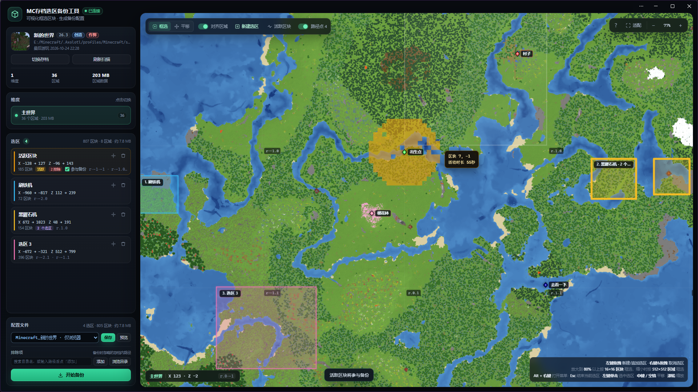

# PartialBackuper · Minecraft 存档选区备份工具

对 Minecraft 存档做**部分/选区备份**：只备份你关心的区域（区块级裁剪），而不是整个存档。
提供两种用法——**图形化网页框选工具**（推荐）和**配置文件驱动的命令行备份**。

> 本仓库是 [Yinhe2332767/PartialBackuper](https://github.com/Yinhe2332767/PartialBackuper) 的 fork，
> 在原命令行工具之上新增了 `map_selector/` 网页选区工具。许可与来源声明见文末与 [`NOTICE`](./NOTICE)。

> **文档说明**：本 README 由 [Qoder](https://qoder.com) 生成，并随功能改动持续更新；内容以实际运行验证为准，
> 如与程序行为不一致，请以代码为准。

---

## 界面预览



左侧依次是存档概况（维度 / 区域 / 数据量）、维度切换、选区列表（含「活跃区块」）与配置文件、排除项；
右侧地图按区域文件渲染地形，可框选区块、悬停查看区块活动时长、显示 Xaero 路径点，选好后可直接备份。

---

## 环境要求

- **Python 3**（仅需标准库，**无需 `pip install` 任何第三方包**；`http.server`、`pathlib`、`gzip`、`struct` 等自 3.7 起可用。开发与测试环境为 Python 3.15）。
- 提供 `.bat` 双击入口，面向 **Windows**；其他系统直接用 `python <脚本>` 运行。
- 网页工具在本机回环地址 `127.0.0.1` 上运行，不对外网开放。

---

## 快速开始

### 方式 A：网页选区工具（推荐，图形化框选）

1. **双击仓库根目录的 [`start_map.bat`](./start_map.bat)**（或 [`map_selector/start_map.bat`](./map_selector/start_map.bat)，二者等价）。
2. 服务会在自己的控制台窗口里启动，并尝试打开页面：
   - 若 `map_selector/app.lnk` 存在，优先通过它启动；
   - 否则用本机 Chromium 系浏览器（Chrome / Edge 等）以**应用窗口**（`--app`）方式打开；
   - 都不可用时回退为普通浏览器标签页。
   默认地址 <http://127.0.0.1:8787/>；若 `8787` 被占用，会自动向后查找可用端口（`8787`–`8816`）。
3. 在页面里点 **直接打开存档**，再点 **浏览…** 从系统窗口选择存档文件夹（也可直接粘贴路径）
   → 自动按存档路径匹配已有配置：命中就加载该配置；没命中会新建一份**仅浏览器配置**
   （只存在本机浏览器里，关闭页面不会丢失，也不会弹“未保存”提示）
   → 在地图上**框选**要备份的区域（可细化到区块）
   → 需要落盘时在左侧「配置文件」点 **保存**（会自动存为 `实例名_存档名.json`，例如 `养老生存_一辈子的生存档.json`；
   存档不在实例目录（`saves` 的上一级）下时，只用存档名）。**只有手动点保存才会写入配置文件**，
   直接点备份不会把浏览器配置落盘，备份时用的是浏览器里当前的配置内容
   → 点击**备份**。备份会调用同一 Python 解释器运行 `backup_runner.py` 完成裁剪与打包。
4. 下次使用时，在「配置文件」的下拉框里**选中已有配置即切换**，无需再点加载，存档和选区会自动恢复；
   下拉框会同时列出磁盘配置和**所有仅浏览器配置**（后缀「· 仅浏览器」），
   选中浏览器配置会直接打开它对应的存档，刷新页面也会自动回到上次的浏览器配置；
   若当前是本地配置且有未保存的修改，会先问是否保存。之后的改动点 **保存** 会直接写回当前配置
   （同名文件已存在时也是直接覆盖，原文件会自动留一份 `.bak`）。

> 浏览器不允许网页读取拖入文件夹的完整路径，因此不能把存档文件夹拖进窗口直接打开；
> 请用 **浏览…** 选择。

> **右键框选删除区块**：放大到 **80%** 以上后，右键单击删除一个区块，**按住右键拖拽框选，松开后删除框内的区块**；
> 该操作**只作用于当前选区**（选区卡片上标有「当前」），不会影响其他选区；活跃选区没有设为当前时也不会被改动。删除后可以点「撤销」整批恢复。
> 在活动选区里右键改为**标记可抛弃**：区块正中间会显示红叉并留在选区里，再次右键即可恢复；标记只在备份时排除，重新扫描也不会丢失。
> 首次右键会弹出一次操作说明，之后可以点地图右上角的 **?** 重新查看。
>
> 如果右键拖拽触发了鼠标手势（例如页面后退、关闭标签页），先分辨来源：
>
> - **Edge 自带手势**：打开 Edge「设置 → 外观」，关闭「启用鼠标手势」（或在设置顶部搜索“手势”）。
>   PWA 应用窗口没有地址栏，需要在普通 Edge 窗口里修改，设置对所有 Edge 窗口生效。
> - **鼠标手势扩展**：在普通浏览器窗口打开 `edge://extensions`（Chrome 为 `chrome://extensions`），
>   临时停用该扩展，或在其设置里取消「右键拖拽」手势。
>
> 网页无法自动关闭这两类设置，改完刷新本页即可。

**停止服务**

- 在服务窗口按 `Ctrl+C`；
- 或**关闭所有已打开的页面**：服务端在最后一个页面断开约 1 秒后会自动停止并关闭窗口（若有备份正在运行，会等备份结束后再自动停止）；
- 若启动失败：会打印错误（`--verbose` 时打印完整堆栈），并在 **3 秒后自动关闭窗口**。

**页面右上角的服务状态指示**

标题旁的状态胶囊会显示 `连接中` / `已连接` / `已断开`：

- 页面每 5 秒向后端发一次心跳；
- 当显示 `已断开` 时，**点击该指示器**会尝试通过自定义协议 `mcbackup://` 重新拉起后端（需先注册协议，见下节）；
- 页面切回前台时会立即刷新一次状态。

**命令行参数**（可选，加在 `python server.py` 后面；用 `.bat` 时可把它们追加到 `start_map.bat` 的调用里）：

| 参数 | 说明 |
| --- | --- |
| `--world <存档目录>` | 启动即加载该存档（路径会记到 `map_selector/world.json`） |
| `--port <端口>` | **固定端口**：指定后只使用该端口，被占用则报错退出；**不指定**时从 `8787` 起自动寻找可用端口 |
| `--no-browser` | 启动后不自动打开页面 |
| `--verbose` | 打印详细日志与启动失败堆栈 |

手动启动（等价于 `.bat` 做的事）：

```bash
cd map_selector
python server.py            # 可选：--world "路径" --port 8787 --no-browser --verbose
```

### 方式 A+：安装为桌面应用（PWA，推荐长期使用）

这个网页工具可以像本地程序一样安装到桌面，用独立窗口运行。

**为什么值得装**

- 独立窗口：没有地址栏和标签栏，使用起来就是一个桌面程序；
- 固定到开始菜单 / 任务栏后，双击图标即可打开，不用每次去找 `start_map.bat`；
- 关闭窗口后，服务会在约 1 秒后自动停止，不会在后台常驻；
- 下次点图标时如果服务没在运行，看到的不会是浏览器的“无法访问此网站”，
  而是一个写着 **启动服务** 的提示页面，点一下就把它拉起来
  （需先注册 `mcbackup://`，见下一节；希望点图标就直接启动的可选做法见再下一节）。

**安装步骤**

1. 双击 [`start_map.bat`](./start_map.bat) 启动服务，建议固定 `8787` 端口（见下方警告）；
2. 用 Edge / Chrome 打开 <http://127.0.0.1:8787/>；
3. 点地址栏右侧的 **安装** 图标；也可以打开浏览器菜单，选择 **应用 → 安装此网站为应用**
   （不同浏览器版本的措辞略有差异）；
4. 安装完成后，即可从开始菜单、桌面或任务栏图标打开。

> ⚠️ **PWA 会绑定安装时的端口。** 若希望安装后的应用长期可用，请让服务**固定端口**启动
> （`start_map.bat --port 8787`）。不指定 `--port` 时，8787 被占用会自动向后换端口，
> 装好的应用就会连不上。

**可选：`app.lnk` 快捷方式**
[`map_selector/app.lnk`](./map_selector/app.lnk) 是可选的本地快捷方式：可以是浏览器安装 PWA 时
生成的应用快捷方式，也可以指向 `chrome.exe --app=http://127.0.0.1:8787/`。
存在时 `start_map.bat` 会优先用它打开页面；它**不随仓库分发**（已在 `.gitignore` 中忽略），
没有它时会自动回退到浏览器 / 应用窗口方式。

### 注册 `mcbackup://` 协议（可选，让应用里的「启动服务」按钮可用）

服务在最后一个页面关闭后会停止。安装成 PWA 后，下次直接点应用图标时服务通常没在运行，
应用会显示一个“服务未运行”的提示页面。页面上的 **启动服务** 按钮，以及已打开页面上
显示服务状态的按钮在断线后点击重连，都通过 `mcbackup://backend?port=<端口>` 调用启动脚本。
这需要先在 Windows 注册该协议。

两种注册方式，**按需选一个**：

| 脚本 | 写入位置 | 权限 | 适用场景 |
| --- | --- | --- | --- |
| [`register_protocol.bat`](./map_selector/register_protocol.bat) | `HKCU\Software\Classes\mcbackup` | 双击即可，**无需管理员** | 仅当前 Windows 用户（推荐） |
| [`register_protocol_admin.bat`](./map_selector/register_protocol_admin.bat) | `HKEY_CLASSES_ROOT\mcbackup` | 需右键**以管理员身份运行** | 整台电脑所有用户共用同一份工具 |

- 只影响“用 `mcbackup://` 拉起服务”这一个功能；不注册也能正常从 `start_map.bat` 启动。
- 两个都注册时，当前用户的那份优先。
- 撤销用户级注册：再次运行 `register_protocol.bat unregister`。
- 撤销整机注册（需管理员）：`reg delete "HKLM\Software\Classes\mcbackup" /f`。
- 脚本只记录 `start_map.bat` 的路径；移动了工具目录后，重新运行一次对应脚本即可。

### 可选：点开应用后自动启动服务（不随仓库提供脚本）

默认行为是：点开应用后先看到一个提示页面，点一次 **启动服务** 即可。这是有意保留的最小侵入方式，原因如下：

- 浏览器规定，跳转到 `mcbackup://` 这类外部协议必须由用户手势触发。页面一加载就自动跳转会被
  Edge / Chrome 直接拦截，**连授权弹窗都不会出现**
  （控制台会提示 `Not allowed to launch ... because a user gesture is required`）。
- 因此项目不默认提供、也不附带任何“自动启动”脚本。协议注册仍然是这个按钮能工作的前提，
  但让服务自动启动不是必须的。

如果你确实希望省掉这一次点击，可以自己选择下面两种方式之一：

**方式 1：启动快捷方式（无需管理员，推荐）**

不用协议、也不用浏览器策略：新建一个指向 [`start_map.bat`](./start_map.bat) 的快捷方式，
固定到任务栏或开始菜单。双击后它会先启动服务，再按方式 A 的规则打开页面 / PWA。

- 优点：零权限、零策略，最可靠；
- 注意：直接点 PWA 自己的图标，看到的仍然是那个提示页面，只有点这个快捷方式才是全自动。

**方式 2：浏览器策略 `AutoLaunchProtocolsFromOrigins`（管理员，进阶）**

如果坚持从 PWA 图标进入并自动拉起，可以给 Edge / Chrome 配置策略，允许来源
`http://127.0.0.1:8787` 直接启动 `mcbackup`。策略命中后不再弹窗，也不再要求手势。

- Edge：`HKLM\SOFTWARE\Policies\Microsoft\Edge`，新建字符串值 `AutoLaunchProtocolsFromOrigins`：

  ```json
  [{"allowed_origins":["http://127.0.0.1:8787"],"protocol":"mcbackup"}]
  ```

- Chrome：把同样的值写到 `HKLM\SOFTWARE\Policies\Google\Chrome`。
- 仍然需要先完成上面的协议注册，这条策略只是免去点击和弹窗。
- 需要管理员权限，且 Edge / Chrome 需要分别配置；改完建议重启浏览器，可在
  `edge://policy/` 或 `chrome://policy/` 确认策略已生效。
- 来源包含端口，因此服务必须固定 `8787` 启动，否则策略不匹配。
- 这是**完全跳过确认**：策略生效后不会再询问。
- 撤销：删除对应的 `AutoLaunchProtocolsFromOrigins` 值即可。
- 该策略允许来源下的任何页面触发 `mcbackup://`；来源只限本机 `8787`，风险可控，
  但仍属于修改浏览器全局策略，请自行判断是否采用。

### 方式 B：配置文件驱动的命令行备份（原始用法）

1. 进入 [`configs/`](./configs)，为**每个**要备份的存档复制一份
   [`config_template.json`](./configs/config_template.json) 并按说明填写
   （字段含义与示例见 [`configs/README_config.txt`](./configs/README_config.txt)）。
2. **双击 [`run_script.bat`](./run_script.bat)**（等价于 `python script.py`）。
3. 备份 zip 会生成在**每个存档所在的相同路径**下。
4. 若要读取 `configs/` 以外位置的配置，在 [`global_config.json`](./global_config.json) 的 `config_paths` 中注册（填目录则把其下每个 `.json` 当作一份配置，忽略子目录）。

---

## 恢复备份

- 若可以接受“未备份的部分继续存在”：直接解压备份，把文件复制回原存档、覆盖所有同名文件即可。
- 若不能接受（例如替换后仍无法进入存档）：在合理配置下，解压出来的备份本身即可当作一个完整存档直接使用。

> ⚠️ **务必检查路径拼写。** 脚本不含任何纠错功能。

---

## 卸载

双击根目录的 [`uninstall.bat`](./uninstall.bat)，按提示输入 `yes` 确认即可。它会：

- 清理 `mcbackup://` 协议注册（当前用户；若曾用管理员脚本注册，需以管理员身份运行本脚本才能一并清理）；
- 删除程序文件（服务端、网页界面、启动与注册脚本、说明文档）；
- 保留你的数据：`configs/`、`global_config.json`、`map_selector/world.json`、`map_selector/.cache/`，
  以及各存档目录里的备份 zip。

卸载结束后会列出保留的内容和位置，如不再需要可自行删除；想彻底清除时直接删除整个文件夹即可。
浏览器里安装的 PWA 无法由脚本移除，请在 Edge / Chrome 的“应用”页面手动卸载。

> `.git` 目录（如果存在）和用户自己放入的其它文件不会被删除。若提示部分文件未能删除，
> 关闭服务窗口和浏览器页面后重新运行脚本即可（此时脚本会保留以便重试）。

---

## 目录结构

```
.
├─ start_map.bat            # 网页选区工具的根目录入口（推荐双击）
├─ run_script.bat           # 命令行备份入口（python script.py）
├─ uninstall.bat            # 卸载：清理协议注册与程序文件，保留配置与缓存
├─ script.py                # 原始命令行备份调度
├─ backup_runner.py         # 实际执行裁剪/打包（网页工具的“备份”按钮也调用它）
├─ global_config.json       # 语言、config 读取路径等全局设置
├─ requirements.txt         # 依赖说明（本项目仅需 Python 标准库）
├─ screenshot.png           # 界面预览图（文档用）
├─ configs/                 # 备份配置（内含模板与说明；个人配置默认不纳入版本控制）
└─ map_selector/            # 网页选区工具
   ├─ start_map.bat         # 本工具的启动入口
   ├─ register_protocol.bat        # 注册 mcbackup://（当前用户，免管理员；unregister 撤销）
   ├─ register_protocol_admin.bat  # 注册 mcbackup://（整机所有用户，需管理员）
   ├─ server.py             # 本地 HTTP 服务 + 瓦片/活动/备份/心跳接口
   ├─ renderer.py           # MCA/NBT 解析与地图渲染
   ├─ world.json            # 上次打开的存档（本机生成，不入库）
   ├─ app.lnk               # 可选的 PWA 快捷方式（本机生成，不入库）
   ├─ .cache/               # 地图瓦片缓存（本机生成，不入库）
   └─ public/               # 前端（原生 JS，无构建步骤）
      ├─ index.html
      ├─ app.js             # 界面、框选、心跳与服务状态
      ├─ style.css
      ├─ offline.html       # 服务未运行时的提示页
      ├─ sw.js              # Service Worker（只缓存静态外壳，不拦截 /api/）
      ├─ manifest.webmanifest
      └─ icon.svg / icon-192.png / icon-512.png
```

---

## 关于依赖 / `requirements.txt`

本项目的全部代码只使用 **Python 标准库**，没有任何第三方依赖，因此不需要执行
`pip install -r requirements.txt`。`requirements.txt` 现仅作为依赖说明保留。

---

## 许可与来源声明

- 本 fork 中对**新增/重写**的代码（主要是 `map_selector/` 网页工具与启动脚本）采用 **GNU AGPL-3.0**，见 [`LICENSE`](./LICENSE) 与 [`NOTICE`](./NOTICE)。采用 AGPL 的意图是：本作品保持自由，且不以闭源形式被商用；通过网络提供该服务时也须开放源码。
- **上游 [`Yinhe2332767/PartialBackuper`](https://github.com/Yinhe2332767/PartialBackuper) 目前没有许可证**（法律上默认“保留所有权利”）。因此：
  1. 若原作者提出要求，本仓库将下线（设为私有或删除）。
  2. 若上游日后为其代码补充许可证，本 fork 将针对继承而来的代码相应调整本仓库的许可条款。
- `script.py`、`backup_runner.py`、`global_config.json`、`requirements.txt`、`run_script.bat`、`configs/` 模板与说明等继承文件的著作权归原作者。

## 致谢

原作者 **Yinhe233**（原仓库说明：“作者：Yinhe233，主要代码由 AI 生成”）。
